<!-- Generated by scripts/build.py from content.json. Do not edit by hand: the Action rewrites it. -->

<a href="https://gabriellsar.dev"><picture><source media="(prefers-color-scheme: light)" srcset="assets/hero-light.svg"></picture></a>

  

<picture><source media="(prefers-color-scheme: light)" srcset="assets/section-1-light.svg"></picture>

 

<a href="https://github.com/gabriellsar/predictive-cloud-autoscaling"><picture><source media="(prefers-color-scheme: light)" srcset="assets/pinned-1-light.svg"></picture></a>
<a href="https://github.com/gabriellsar/windanalyzer"><picture><source media="(prefers-color-scheme: light)" srcset="assets/pinned-2-light.svg"></picture></a>
<a href="https://github.com/gabriellsar/kalman-hackathon-vx"><picture><source media="(prefers-color-scheme: light)" srcset="assets/pinned-3-light.svg"></picture></a>
<a href="https://github.com/gabriellsar/portfolio"><picture><source media="(prefers-color-scheme: light)" srcset="assets/pinned-4-light.svg"></picture></a>

  

<picture><source media="(prefers-color-scheme: light)" srcset="assets/section-2-light.svg"></picture>

 

<picture><source media="(prefers-color-scheme: light)" srcset="assets/activity-light.svg"></picture>

   

<picture><source media="(prefers-color-scheme: light)" srcset="assets/section-3-light.svg"></picture>

 

<a href="https://gabriellsar.dev"><picture><source media="(prefers-color-scheme: light)" srcset="assets/link-1-light.svg"></picture></a>
<a href="https://www.linkedin.com/in/gabriellsar"><picture><source media="(prefers-color-scheme: light)" srcset="assets/link-2-light.svg"></picture></a>
<a href="mailto:gabrielsrosas@gmail.com"><picture><source media="(prefers-color-scheme: light)" srcset="assets/link-3-light.svg"></picture></a>
<a href="https://gabriellsar.dev/cv.pdf"><picture><source media="(prefers-color-scheme: light)" srcset="assets/link-4-light.svg"></picture></a>

   

<picture><source media="(prefers-color-scheme: light)" srcset="assets/footer-light.svg"></picture>
